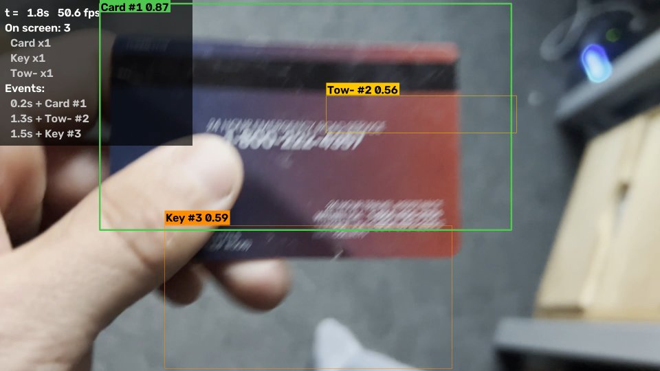
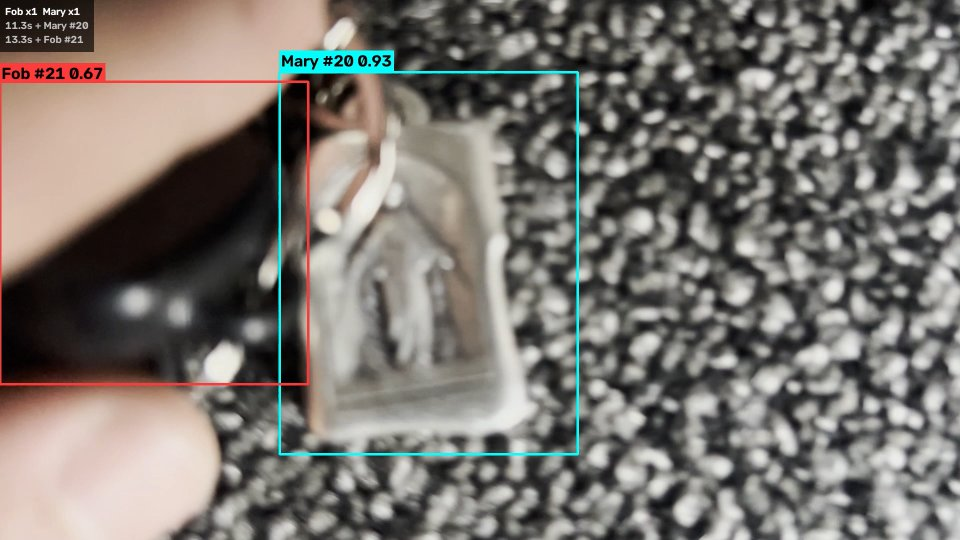
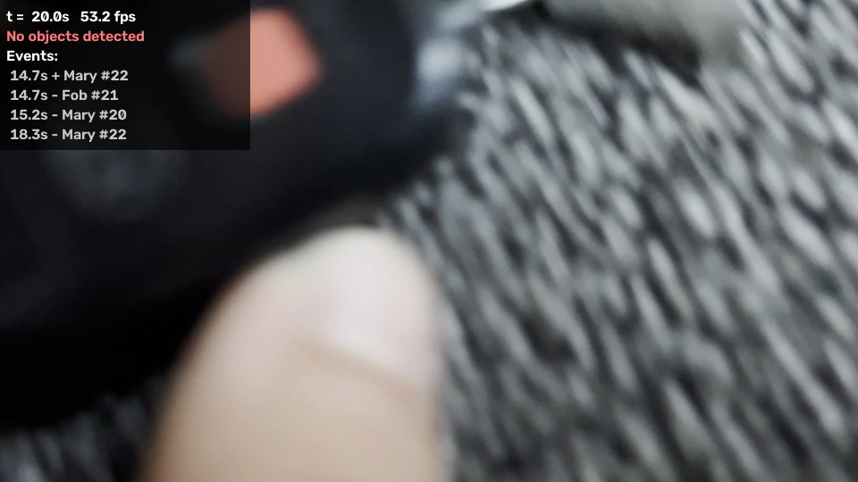

# Object Sonifier

Objects detected in this video instigate sound output from a supercollider program. Each object in the video (road side assistance card, car key, fob, keychain saints) are assigned a note, which is played in a cloud of granular synth sounds when the associated object appears. 



| Fob and Mary medal | Nothing detected |
|---|---|
|  |  |

**Watch with sound:** [samples/preview_with_sound.mp4](samples/preview_with_sound.mp4), the trimmed demo with the granular sonification rendered in sync (made with `--render-preview`). Full-length silent run: [samples/demo_annotated.mp4](samples/demo_annotated.mp4)

## What it detects

A YOLOv8n model fine-tuned on frames from my own video, with 7 classes:

| Class | What it is |
|---|---|
| `Card` | roadside-assistance card |
| `Tow-` | the tow/road service phone number printed on the card |
| `cotwo` | button on the key fob |
| `Saint Christopher` | Saint Christopher keychain medal |
| `Mary` | Mary keychain medal |
| `Fob` | car alarm key fob |
| `Key` | car key |

None of these exist in standard pretrained datasets (COCO has no keys, cards or fobs), so a pretrained model alone couldn't do this.

## Model and why

- **YOLOv8n (nano), fine-tuned** with Ultralytics on Google Colab's free GPU ([training/fine_tune_yolo.ipynb](training/fine_tune_yolo.ipynb)). Fine-tuning from COCO weights learns new classes from very little data. Here, 68 labeled frames.
- **Nano** because inference runs on a 2019 Intel MacBook Pro CPU. Larger models would be too slow for playback.
- **Exported to ONNX and run with OpenCV's `cv2.dnn`**, so running the project needs only OpenCV and NumPy.

Training data: 853 frames were extracted from the video, 68 were labeled in [makesense.ai](https://www.makesense.ai) (labels in [labels/](labels/)), and split 56 train / 12 validation by video section rather than at random, so near-identical neighboring frames don't make the validation score look better than it is.

## How it works

```
video frame ─► detector.py ─► tracker.py ─► enter / exit events ─┬─► events.csv + terminal log
 (every 2nd    YOLOv8 ONNX     match boxes                       ├─► crops/ (snapshot of each object)
  frame)       + NMS           to tracks                         ├─► sonify.py ──OSC──► SuperCollider
                                                                 └─► on-screen boxes, counts, recent events
```

1. **Read** a frame with `cv2.VideoCapture`.
2. **Detect** ([detector.py](detector.py)): resize to 640×640 into a blob, run the network, and decode its `(1, 11, 8400)` output: 8400 candidate boxes, each with 4 box values and 7 class scores. The highest score is the class and confidence; candidates under 0.5 are dropped. Boxes are scaled back to frame pixels, and per-class non-max suppression (`NMSBoxesBatched`) removes duplicates. The decoding is vectorized with NumPy, which made it about 100× faster than a Python loop. The model runs on every 2nd frame (`--detect-every`), and the boxes carry over in between.
3. **Track** ([tracker.py](tracker.py)): each detection is matched to the nearest existing track of the same class. A track is **confirmed** after 4 matches, which filters out one-off false positives, and **removed** after 8 detection runs without a match, which rides out brief motion blur. Confirming produces an `enter` event; removing a confirmed track produces an `exit` event.
4. **Act on events** ([main.py](main.py)): log them, save a crop, send OSC, and draw the result.
5. **No detections** : the detector returns an empty list, the corner panel shows *"No objects detected"*, and the summary says *"No objects were detected."* if nothing ever appears (covered by [tests/test_no_detections.py](tests/test_no_detections.py)).

## Custom behavior

### 1. Granular sonification with SuperCollider
[sonify.py](sonify.py) sends OSC messages to [supercollider/sonify.scd](supercollider/sonify.scd):

| Message | Sent when | Sound |
|---|---|---|
| `/detect/enter id class_id name x y size conf` | an object is confirmed | a burst of sine grains (`GrainSin`) an octave above the object's note whose pitch climbs steeply and which keeps sounding (by design it doesn't decay); its grain cloud starts |
| `/detect/update id x y size conf` | every detection run, for each tracked object | the FM grain cloud (`GrainFM`) follows the object: **x → where grains land in the stereo field, size → grain density and volume, height on screen → grain length and brightness** (higher = shorter, brighter grains) |
| `/detect/exit id class_id name seconds` | an object leaves | a softer grain burst that slides down an octave, and its cloud fades out |
| `/detect/clear` | the program ends | all clouds fade out |

Each class has its own low base note, one semitone apart (Card A0 up to Key D#1), with grain pitches multiplied by random ratios chosen each time the sounds load, so every session sounds a little different. The mix is deliberately dense and overdriven: arrival bursts sustain and pile up, and the output clips. Every sound is made of short grains: there are no plain oscillators or filters. The sound design lives in [supercollider/sounds.scd](supercollider/sounds.scd); [sound.scd](sound.scd) is the same design as a standalone live script.

### 2. Tracking with IDs
Objects keep an ID (`Key #3`) while they stay on screen. A thick box means the object was seen in the latest detection run; a thin box means it's briefly lost and being held at its last position.

### 3. Event log, crops and analytics
- `output/events.csv`: every enter/exit with time, track ID, class, confidence, box, and how long the object was on screen.
- `output/crops/`: a cropped image of each object at the moment it was confirmed.
- `output/summary.txt`: appearances and total seconds on screen per class, also printed at the end.

## Install

Tested on macOS 15 (Intel) with Python 3.13 and SuperCollider 3.14.

```bash
git clone https://github.com/lukasniswonger/ACM-Computer-Vision-Project.git
cd ACM-Computer-Vision-Project
python3 -m venv .venv
source .venv/bin/activate
pip install -r requirements.txt
```

For sound, install [SuperCollider](https://supercollider.github.io/downloads). It isn't needed to run detection (`--no-audio`).
For the preview video with sound (`--render-preview`), also install ffmpeg: `brew install ffmpeg`, or put an `ffmpeg` binary in `bin/` (on Intel Macs, where Homebrew compiles from source, a prebuilt one from [evermeet.cx](https://evermeet.cx/ffmpeg/) is much faster).

## Run

**1. Start the sound engine.** Either open `supercollider/sonify.scd` in the SuperCollider IDE, click anywhere inside the outer parentheses and press **Cmd+Return**, or from a terminal:

```bash
/Applications/SuperCollider.app/Contents/MacOS/sclang supercollider/sonify.scd
```

Wait for `Object Sonifier ready, listening on port 57120`. If it reports a different port (for example 57121, because another SuperCollider instance already has 57120), pass that port with `--osc-port`.

**2. Run the detector** (in another terminal, with the virtual environment active):

```bash
python main.py
```

By default this plays [videos/demo_detected.mp4](videos/demo_detected.mp4), the demo trimmed to the parts where objects are detected (made with `tools/cut_to_detections.py`). Press `q` or Esc to stop. Other ways to run it:

```bash
python main.py --no-audio                              # detection only, no SuperCollider
python main.py --no-display --save-video --no-audio    # render output/annotated.mp4 without a window
python main.py --video path/to/other.mov --conf 0.4    # another video / threshold
python main.py --detect-every 1                        # run the model on every frame (slower, smoother)
python main.py --video videos/demo.mov                 # the full, untrimmed demo
```

**Preview video with sound.** This renders a shareable `output/preview.mp4`: the annotated video plus the granular sonification, perfectly in sync. SuperCollider doesn't need to be running.

```bash
python main.py --no-display --no-audio --render-preview
```

While detecting, every OSC message is also recorded with its video timestamp ([sonify.py](sonify.py)). Afterwards [preview.py](preview.py) writes them to `output/score.scd`, has SuperCollider render them offline with the same sounds ([supercollider/render_score.scd](supercollider/render_score.scd)) to `output/sonification.wav`, and ffmpeg combines the video and audio (H.264 CRF 18, AAC 256 kbps, loudness-normalized). Because the audio is rendered against video time instead of recorded live, it stays in sync however fast detection runs.

**Trim a video** to only the parts where objects are detected:

```bash
python tools/cut_to_detections.py videos/demo.mov videos/demo_detected.mp4
```

**Test** the "no objects" handling:

```bash
python tests/test_no_detections.py
```

## Sample output

From `python main.py --no-display --save-video --no-audio` on [videos/demo.mov](videos/demo.mov) (all in [samples/](samples/)):

```
[  0.20s] enter Card #1
[  1.33s] enter Tow- #2
[  1.53s] enter Key #3
...
[ 25.87s] enter Mary #28
[ 27.73s] exit  Mary #28 (1.7s on screen)

Summary of 28.4s of video
class                appearances   seconds on screen
Card                           2                 4.7
Fob                            1                 1.0
Key                            1                 1.0
Mary                           3                 8.8
Tow-                           2                 2.5
```

- [samples/preview_with_sound.mp4](samples/preview_with_sound.mp4): annotated preview with sound, 1920×1080 (from `--render-preview` on the trimmed demo)
- [samples/demo_annotated.mp4](samples/demo_annotated.mp4): the annotated video (downscaled to 960×540)
- [samples/events.csv](samples/events.csv), [samples/summary.txt](samples/summary.txt), [samples/console_output.txt](samples/console_output.txt)
- [samples/crops/](samples/crops/): snapshots taken on each `enter`

## Reproducing the training

```bash
python tools/extract_frames.py videos/demo.mov frames/
# label frames in makesense.ai, export "YOLO" format, unzip into labels/
python tools/build_dataset.py frames/ labels/ dataset.zip
```

Then open [training/fine_tune_yolo.ipynb](training/fine_tune_yolo.ipynb) in Google Colab (T4 GPU), upload `dataset.zip`, and run all cells. It trains, shows validation metrics, and downloads `best.onnx`, `best.pt` and `classes.txt` for `model/`.

## Project structure

```
main.py                    entry point: video loop, events, drawing, logging, CLI
detector.py                YOLOv8 ONNX inference + output decoding with OpenCV DNN
tracker.py                 centroid tracker producing enter/exit events
sonify.py                  OSC messages to SuperCollider
preview.py                 renders the preview video with sound (score -> SuperCollider NRT -> ffmpeg)
supercollider/sounds.scd   the granular SynthDefs and detection -> sound mappings (shared)
supercollider/sonify.scd   live: OSC handlers that play the sounds
supercollider/render_score.scd  offline: renders a recorded score to WAV
model/                     best.onnx (used), best.pt (for retraining), classes.txt
videos/demo.mov            demo input (full recording)
videos/demo_detected.mp4   demo trimmed to the detected parts (default input)
labels/                    makesense.ai YOLO labels for the 68 training frames
tools/                     frame extraction, dataset building, trimming to detections
training/                  Colab fine-tuning notebook
tests/                     no-detection test
samples/                   example output
```

## Limitations

- **Small dataset from one video.** 68 labeled frames is enough for the card and its number, but `Key`, `Fob` and the medals are missed often (for example, the key at the end of the demo), and `cotwo` and `Saint Christopher` (4–5 training boxes each) are effectively never detected. The model is also tuned to this room, lighting and camera, so it will generalize poorly.
- **Some false positives** remain: a hand or the fob is occasionally labeled `Mary`. The tracker's 4-hit confirmation removes the short ones.
- **HDR input.** The iPhone recorded HDR (HLG) video, which OpenCV decodes without tone mapping, so frames look washed out. The model was trained on those same frames, so it's consistent, but SDR footage would need converting or retraining.
- **Stretched input.** Frames are stretched to 640×640 rather than letterboxed as in training, which distorts shapes slightly.
- **Simple tracker.** Matching is per class by distance, so two identical objects crossing paths could swap IDs, and exits are reported ~0.5 s after the object is last seen.
- **Speed.** One model pass takes ~55 ms on a 2019 Intel MacBook Pro CPU, which is why it runs on every 2nd frame (about 50 fps processed without a window; with a window, playback is capped at the video's 30 fps). With `--detect-every 1` it falls below real time.

## Improvements I'd make

- Label more frames (especially keys, fob and the two medals) from several videos and lighting conditions, with hard examples like motion blur and partial views.
- Letterbox the input to match training, and try a 416×416 export for speed.
- Replace the centroid tracker with ByteTrack or an IoU/Kalman tracker.
- Run on a live webcam, and make the sonification richer: rhythm from object speed, or chords from which objects appear together.
